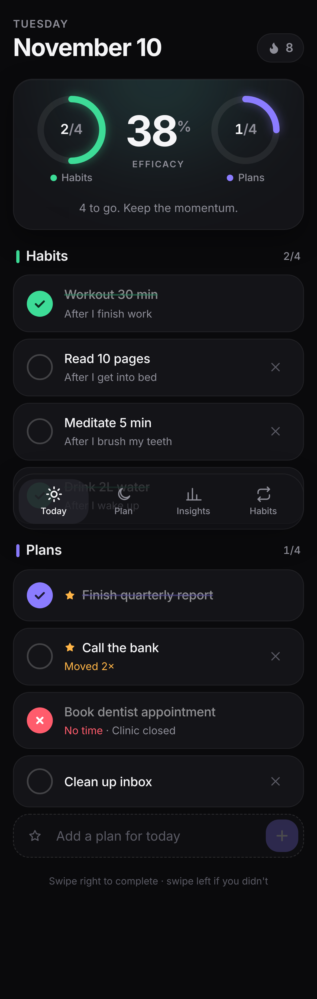
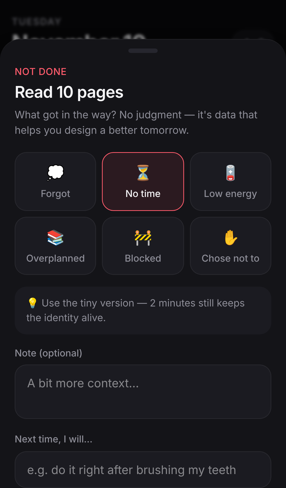
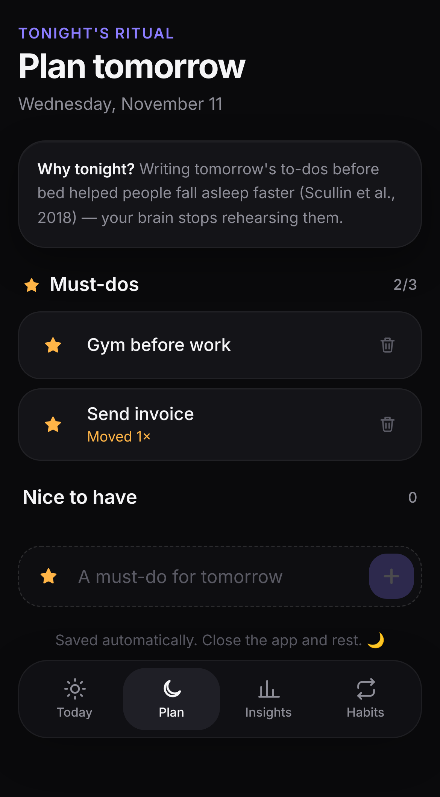
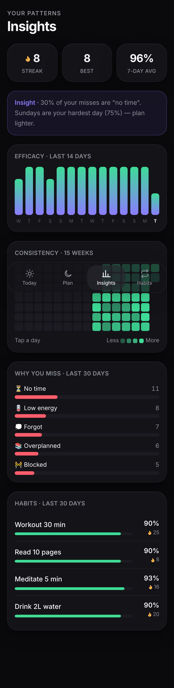

# Keep · Habit Tracker

A mobile-first habit tracker built around accountability: daily **habits** (non-negotiables), daily **plans** (set the night before), and an honest **efficacy score**. Every miss needs a reason.

## Features

- **Two rings + efficacy score** — Habits (left) and Plans (right), combined 50/50 into a daily efficacy %.
- **Tick or cross** — tap the circle or swipe right to complete; tap × or swipe left to log a miss.
- **Reasons for every miss** — one-tap reasons (Forgot, No time, Low energy, Overplanned, Blocked, Chose not to), optional note, and a "Next time, I will…" coping plan that can become the habit's new trigger.
- **Plan tomorrow tonight** — evening ritual screen with max-3 must-dos and a planning-fallacy warning when you plan more than you usually finish.
- **Carry over plans** — undone plans can move forward (still needs a reason); a "moved N×" counter exposes procrastination.
- **Strict streaks** — the streak only grows on days you complete *every* habit.
- **2 am day cutoff** — late-night ticks count for the day you were living.
- **Close the loop** — unresolved items from previous days are surfaced for review.
- **Insights** — 14-day efficacy bars, 15-week consistency heatmap, why-you-miss breakdown, weekday patterns, per-habit 30-day rates.
- **Habit triggers + tiny versions** — "After I…" implementation intentions and a 2-minute fallback shown in the evening.
- **Delight** — spring animations, animated checkmarks, haptics, confetti on all-habits-done and perfect days.
- **PWA** — installable to the home screen, works offline. Dark & light themes follow the system.

Data is stored locally on your device (localStorage). Cloud sync is planned for the mobile app.

## Develop

```bash
npm install
npm run dev      # http://localhost:5173
npm test         # scoring/streak unit tests
npm run build    # production build in dist/
```

Stack: React 19, TypeScript, Vite, Tailwind CSS v4, Framer Motion, Zustand.

## Deploy

`.github/workflows/deploy.yml` publishes `main` to GitHub Pages. Enable it once under **Settings → Pages → Source: GitHub Actions**.

See [`docs/DESIGN.md`](docs/DESIGN.md) for the product design and the behavioural science behind it.

## Screenshots

| Today | Missed → reason | Plan tomorrow | Insights |
|---|---|---|---|
|  |  |  |  |
